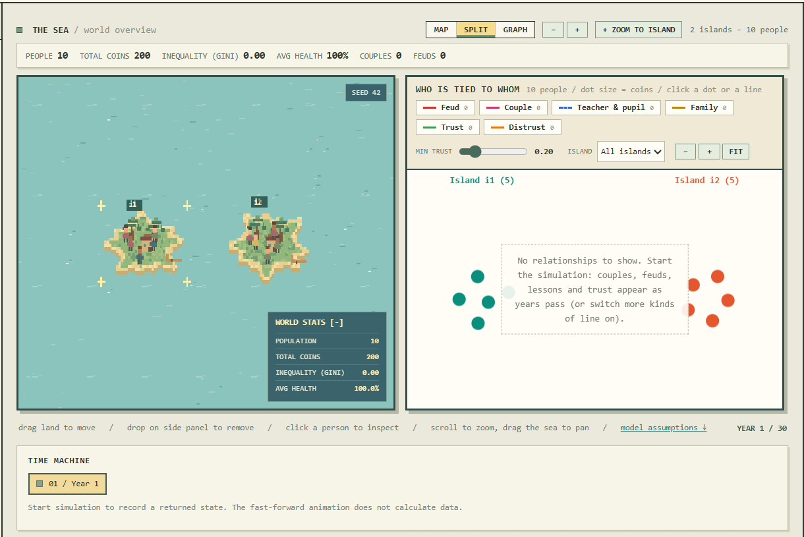
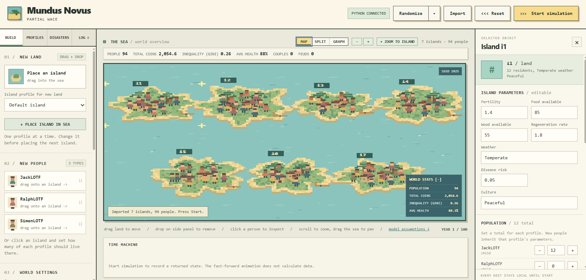
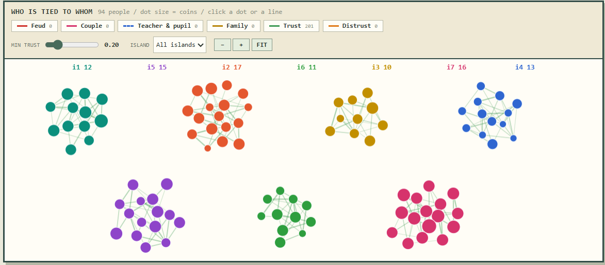
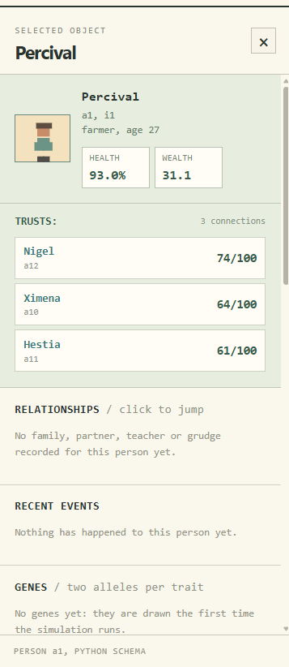
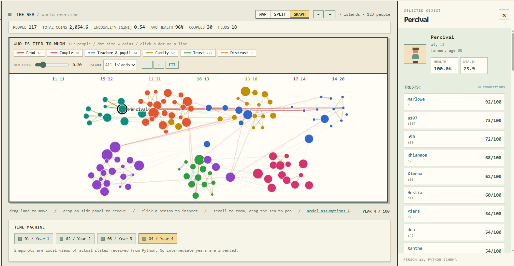

# WHACK-26

<h2>Warwick Hackathon 26 Project | Mundus Novus</h4>
<h3> Team: Partial Wace<h5>

  
Team Members: 
 
<ul> 
    <li>Jacob -- Pipeline & Integration</li>
    <li>Theo -- Frontend</li>
    <li>Angshuman -- Backend & Algorithm</li>
    <li>Shiraz -- Backend & Algorithm</li>
</ul>

<h3> Project Summary & Images</h3>
Our project is a simulation of a fictional society on an isolated island. Here are a few screenshots. 

 
    
    
    
    
    

<h3> Post-Project Writeup </h3>
I will write this later after we're done to summarise my own final thoughts -- Jacob